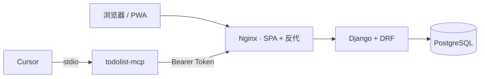

# ToDoList

[](LICENSE)
[](docs/deployment.md)
[](#技术栈)
[](MCP.md)

> **给开发者的项目级待办中枢。**  
> 一个 Workspace = 一个项目 / 一个版本。把散落在聊天、会议纪要、便签里的事，收成你随时能打开、能筛、能写回 Cursor 的结构化待办。

黑白极简 · 中英双语 · 可安装 PWA · 一条命令自托管 · 可选 AI 录入 · **原生 Cursor MCP**


---

## 它在解决什么问题

AI 写代码越来越快，真正拖进度的往往是另一件事——**上下文散了**：

| 痛点 | 常见下场 |
| --- | --- |
| 开版本时决策、约束、会议结论散落各处 | 三周后没人记得「为什么当时不这样做」 |
| 跟 AI 协作时注意力沉进局部实现 | 跨会话的长期记忆断掉 |
| 普通 Todo 只有清单，没有「项目/版本」层 | 答不出「这个版本我还欠着哪些事」 |

ToDoList 就干这一件事：给你一个**按项目组织的外脑**，网页能用，Cursor 里也能读写。

---

## 30 秒摸清产品

```
工作区 Workspace          ← 一个项目 / 一个版本
  └── 清单 List           ← 需求 / 开发 / 联调 / 会议…
        └── 任务 Task     ← 状态 · 优先级 · 类型 · 截止日 · 标签 · 子任务
```

打开网页注册账号就能用，**不用事先建超管、不用灌种子数据**。

日常你可以：

- 用键盘 `N` 新建、`/` 搜索、`Esc` 关掉弹层
- 把会议纪要丢进 **AI 录入**（可选）：本地规则能解析的 **0 token**，点了才走模型
- 在 Cursor 里说「把这个版本的待办整理进开发计划」——MCP 真的去拉你的工作区

---

## 功能一览

### 核心待办

- **三层结构**：工作区 → 清单 → 任务（含子任务）
- **状态**：待办 / 进行中 / 受阻 / 完成 —— UI 用形状与填充度表达，不靠彩虹色
- **优先级 / 类型**：紧急→低；开发、会议、沟通、设计、调研、其他
- **截止日 · 标签 · 筛选 · 排序**；批量完成 / 归档 / 删除；拖拽排序 API 已就绪

### 账号与隔离

- 邮箱 + 密码，JWT；access 过期静默刷新
- **每用户数据隔离**，跨用户访问统一 404（有自动化测试）
- 共享工作区的表结构已预埋，邀请 UI 进路线图

### AI 录入（可选，自备 DeepSeek Key）

- 杂乱想法 / 纪要 → 结构化草稿 → 你确认后批量创建
- 形如 `写登录页 @开发 #api !高 明天` 走本地规则，**不花 token**
- Key 只在服务端 Fernet 加密；接口永不回说明文；有日配额兜底  
  细节：[AI 方案](docs/ai-assistant.md)

### Cursor 集成（MCP + Skill）

这是本项目最「开发者向」的一块：

| 能力 | 说明 |
| --- | --- |
| 4 个 MCP 工具 | `list_workspaces` / `get_tasks` / `create_tasks` / `update_tasks` |
| Agent Skill | `todolist-plan`：教 Cursor **何时**该调用、怎么写回 |
| 网页一键下载 | **设置 → Cursor 集成** 下载安装包，另一台机器**不必 clone 整仓** |
| 认证 | 长期 API Token（SHA-256 存摘要，明文只显示一次，可撤销） |

```text
Cursor ──stdio──► todolist-mcp ──HTTP + Bearer──► 本服务 REST API
```

操作指南：[MCP.md](MCP.md) · 设计说明：[mcp-and-skills.md](docs/mcp-and-skills.md)

### 体验

- 中文 / English，明暗主题，偏好持久化
- PWA：可安装；App Shell 预缓存；**离线可读**（离线写入会明确失败，不静默丢）
- 设计系统：[黑白极简](docs/design-system.md) · 375px → 宽屏

---

## 技术栈

| 层 | 选型 |
| --- | --- |
| 前端 | React 19 · TypeScript (strict) · Vite 8 · Tailwind 4 · TanStack Query 5 · React Router 7 · i18next |
| 后端 | Python 3.12 · Django 5.2 LTS · DRF · SimpleJWT · drf-spectacular · psycopg 3 |
| 数据 | PostgreSQL 17 |
| 部署 | Docker Compose · Nginx · Gunicorn |
| PWA | vite-plugin-pwa (Workbox) |
| 集成 | 独立 stdio MCP server（`mcp==2.3.0`） |

生产环境前后端**同源**（Nginx 反代 `/api`）：没有 CORS 纠缠，Service Worker 策略也更简单。



---

## 快速开始

仓库地址：[github.com/yulona126/ToDoList](https://github.com/yulona126/ToDoList)

```bash
git clone https://github.com/yulona126/ToDoList.git
cd ToDoList

cp .env.example .env
# 强烈建议换掉默认密钥：
python3 -c "import secrets; print(secrets.token_urlsafe(64))"
# → 填进 .env 的 DJANGO_SECRET_KEY

docker compose up -d --build
```

首次构建大约 2–4 分钟。起来之后：

| 入口 | 地址 |
| --- | --- |
| **Web** | **http://localhost:8081** |
| API 文档 (Swagger) | http://localhost:8001/api/docs/ |
| Django Admin | http://localhost:8081/admin/ |

打开 8081 → 注册 → 直接用。

```bash
make up                 # docker compose up -d --build
make logs S=backend
make down               # 停掉，数据保留在 volume
```

> 端口：Web **8081**（避开 macOS Docker Desktop 占的 8080），Postgres 宿主机 **5433**。  
> 挂域名、Cloudflare Tunnel：[cloudflare-tunnel.md](docs/cloudflare-tunnel.md)

### 在另一台机器的 Cursor 里接入

1. 本服务网页 → **设置 → Cursor 集成** → 下载 MCP 安装包  
2. 同页 **API Tokens** 新建一个 token  
3. 另一台机器解压后按页面命令 `./install.sh`，写好 `TODOLIST_API_URL` 与 token  
4. Cursor Reload → 问「我有哪些工作区」

完整步骤见 [MCP.md](MCP.md)。

---

## 项目结构

```text
ToDoList/
├── README.md · MCP.md · LICENSE
├── docker-compose.yml · Makefile · .env.example
├── docs/                 架构 / 计划 / 数据模型 / API / 设计 / AI / MCP / 部署 / 路线图
├── backend/              Django + DRF（accounts · todos · assistant）
├── frontend/             React PWA（设置页可下载 Cursor 安装包）
├── mcp/                  独立 stdio MCP server
├── integrations/cursor/  Skill · 安装脚本 · 独立安装包素材
└── scripts/              e2e · backup · restore · pack-cursor-integration · …
```

---

## 常用命令

```bash
make help
make up / down / ps / logs / restart
make shell · make dbshell · make backup

make test-backend          # 后端单测
make typecheck-frontend
make build-frontend        # 会先打包 Cursor 下载 zip
./scripts/e2e.sh           # 端到端验收（需先 make up）
./scripts/pack-cursor-integration.sh   # 刷新 /downloads 下的安装包
```

本地拆开跑（只起库）：

```bash
docker compose up -d db
cd backend  && python manage.py runserver
cd frontend && npm run dev    # http://localhost:5173
```

---

## 文档地图

| 你想知道 | 去这里 |
| --- | --- |
| 为什么这样分层、鉴权与 PWA 怎么取舍 | [架构设计](docs/architecture.md) |
| 里程碑、WBS、验收 | [项目计划书](docs/project-plan.md) |
| 表与业务规则 | [数据模型](docs/data-model.md) |
| 接口契约 | [API](docs/api.md) |
| 黑白设计令牌与组件 | [设计系统](docs/design-system.md) |
| **Cursor 怎么装、怎么用** | **[MCP.md](MCP.md)** |
| MCP / Skill 设计边界 | [Cursor 集成](docs/mcp-and-skills.md) |
| AI 提示词与省 token | [AI 方案](docs/ai-assistant.md) |
| 公网 / Tunnel | [Tunnel](docs/cloudflare-tunnel.md) |
| 备份、排错、限流建议 | [部署手册](docs/deployment.md) |
| 本机开发坑 | [开发指南](docs/development.md) |
| 敏捷流程：需求→验证→开发→自测 | [阶段流水线](docs/stage-pipeline.md) |
| 周迭代与承诺闸门 | [周迭代方案](docs/agile.md) |
| 后面做什么 | [路线图](docs/roadmap.md) |
| **怎么让 AI 真正理解这个项目？** | **[项目理解数据库方案](docs/project-brain.md)** |

---

## 已知限制（V1）

- 工作区**共享**：只有表结构，没有邀请 UI（计划 V1.2）
- 离线：**可读**；断网写入会失败并提示（不做静默丢弃）
- 公网请在反代层限制 `/api/v1/auth/*`（见部署手册）
- 暂无看板拖拽 UI、甘特、日历、全文检索、推送
- refresh token 暂存 localStorage（XSS 面；计划改 HttpOnly Cookie）

这些不是「忘了」，是刻意砍掉的范围，写在路线图里等排期。

---

## 贡献与许可

Issues / PR 欢迎。改 MCP 或 Skill 后记得跑：

```bash
./scripts/pack-cursor-integration.sh
```

保证设置页下载的 zip 与源码一致。

**License: [MIT](LICENSE)** —— 自用、改、再分发都可以；别把你的 API Token 和 `.env` 推上来。
