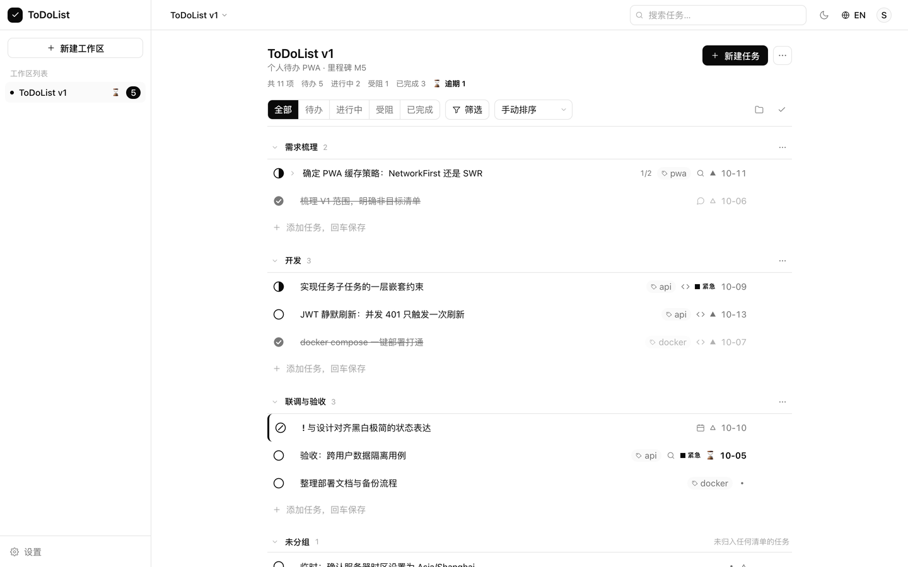

# ToDoList

> 给开发者的**项目级待办中枢** —— 一个 Workspace 对应一个项目或一个版本，
> 把梳理期散落的需求、开发、会议、沟通事项沉淀成结构化待办。
> 黑白极简、中英双语、可安装为 PWA、一条命令自托管。

---

## 为什么做这个

在 AI 辅助编码成为主流的今天，开发者的工作重心前移到了「梳理上下文」：

- 一个版本启动时要沉淀大量决策、约束、待办、会议结论；
- 与 AI 协作时注意力被局部实现牵走，**跨会话的长期记忆会丢失**；
- 普通 Todo 工具缺少「项目/工作区」这一层，回答不了"这个版本我还欠着哪些事"。

这个工具就是为了回答最后那个问题。



---

## 功能

**核心**

- 工作区（项目/版本）→ 清单（需求/开发/联调）→ 任务 三层结构
- 任务支持：状态（待办/进行中/受阻/完成）、优先级、类型（开发/会议/沟通/设计/调研/其他）、截止日、标签、**子任务**
- 一键完成、批量完成/归档/删除、拖拽式排序接口
- 按状态、优先级、类型、标签、清单、截止时间、关键词筛选与排序

**账号与数据**

- 邮箱 + 密码注册登录，JWT 鉴权，access 过期静默刷新
- **每个用户各自的数据**，跨用户访问一律 404（有自动化测试保障）
- 共享工作区的表结构与查询边界已就绪，V1.2 直接开启

**AI 录入（可选，需自备 DeepSeek API Key）**

- 一段杂乱的想法 / 会议纪要 → 结构化任务草稿，确认后批量创建
- **本地规则解析优先**：`写登录页 @开发 #api !高 明天` 这类输入完全不走模型，**0 token**
- 系统提示词逐字节固定以命中上下文缓存、输出用单字符键、只发清单/标签**名字**不发 id、绝不发送工作区内已有任务
- 设置页填写 API Key（服务端 Fernet 加密存储，接口永不返回明文），带「测试连接」与用量统计
- 每日 token 配额兜底，超限直接拒绝
- 详见 [AI 方案](docs/ai-assistant.md)

**体验**

- 中文 / English 一键切换，明暗主题，全站持久化
- PWA：可安装到桌面，App Shell 预缓存，**离线可读**
- 键盘快捷键：`N` 新建、`/` 搜索、`Esc` 关闭、`Cmd/Ctrl+Enter` 提交
- 黑白极简设计，无彩色依赖（状态用形状与填充度表达，见[设计系统](docs/design-system.md)）
- 响应式，从 375px 手机到宽屏

---

## 技术栈

| 层 | 技术 |
| --- | --- |
| 前端 | React 19 · TypeScript 5.9 (strict) · Vite 8 · Tailwind CSS 4 · TanStack Query 5 · React Router 7 · i18next · axios · tailwind-merge |
| 后端 | Python 3.12 · Django 5.2 LTS · DRF 3.18 · SimpleJWT · drf-spectacular · psycopg 3 · httpx · cryptography |
| 数据 | PostgreSQL 17 |
| 部署 | Docker Compose · Nginx · Gunicorn · WhiteNoise |
| PWA | vite-plugin-pwa (Workbox) |

---

## 快速开始

```bash
git clone <repo> ToDoList && cd ToDoList

cp .env.example .env
# 强烈建议设置密钥：
python3 -c "import secrets; print(secrets.token_urlsafe(64))"   # 填进 DJANGO_SECRET_KEY

docker compose up -d --build
```

首次构建约 2–4 分钟。完成后打开：

| 入口 | 地址 |
| --- | --- |
| **Web 应用** | **http://localhost:8081** |
| API 文档 (Swagger) | http://localhost:8001/api/docs/ |
| Django Admin | http://localhost:8081/admin/ |

打开 8081 → 注册一个账号 → 立刻可用。**无需预先创建任何数据或超管。**

```bash
make up      # 等价于 docker compose up -d --build
make logs S=backend
make down    # 停止（保留数据）
```

> 端口说明：Web 用 **8081** 而非 8080（macOS 上 Docker Desktop 自身占用 8080），
> 数据库映射到 **5433**（避开本机常见的 5432）。

---

## 项目结构

```
ToDoList/
├── README.md
├── docker-compose.yml          一条命令拉起 db + backend + frontend
├── .env.example                环境变量契约（全部有默认值）
├── Makefile                    常用操作
├── docs/
│   ├── architecture.md         架构设计：分层、选型理由、鉴权、PWA 策略
│   ├── project-plan.md         详细项目计划书：里程碑、WBS、风险、验收
│   ├── data-model.md           数据模型字段级说明与业务规则
│   ├── api.md                  REST API 契约（前后端唯一事实来源）
│   ├── design-system.md        黑白极简设计系统
│   ├── ai-assistant.md         AI 任务录入方案（模型、提示词、token 经济）
│   ├── deployment.md           部署与运维手册
│   ├── development.md          本地开发指南
│   └── roadmap.md              演进路线 V1.1 → V2.0
├── backend/                    Django + DRF
│   ├── config/                 设置、路由、WSGI/ASGI
│   └── apps/
│       ├── common/             分页、错误信封、权限、mixin
│       ├── accounts/           自定义用户、JWT 认证
│       └── todos/              Workspace / TaskList / Task / Tag
├── frontend/                   React PWA
│   ├── nginx.conf              SPA + 反向代理 + 缓存策略
│   └── src/
│       ├── components/         ui / layout / tasks / workspace / list / auth / pwa
│       ├── pages/              路由页面
│       ├── hooks/              React Query 数据层
│       ├── stores/             会话 / 主题 / 语言
│       ├── i18n/               中文 · English
│       └── types/              与 API 契约对应的 DTO
└── scripts/
    ├── e2e.sh                  端到端验收脚本（51 条断言，全绿）
    ├── backup.sh               数据库备份
    └── restore.sh              数据库还原
```

---

## 常用命令

```bash
make help              # 列出全部命令

# 运维
make up / down / ps / logs / restart
make shell             # Django shell
make dbshell           # psql
make backup            # 备份到 ./backups/

# 质量门禁
make test-backend      # 后端测试（75 例）
make typecheck-frontend
make build-frontend
./scripts/e2e.sh       # 端到端验收（需先 make up）
```

---

## 文档索引

| 想了解 | 看这里 |
| --- | --- |
| 为什么这样设计？有哪些取舍？ | [架构设计](docs/architecture.md) |
| 要做多久？分几期？验收标准是什么？ | [项目计划书](docs/project-plan.md) |
| 表结构、字段含义、业务规则 | [数据模型](docs/data-model.md) |
| 接口怎么调？字段叫什么？ | [API 契约](docs/api.md) |
| 为什么是黑白？组件长什么样？ | [设计系统](docs/design-system.md) |
| AI 怎么接？怎么省 token？ | [AI 方案](docs/ai-assistant.md) |
| 怎么部署？怎么做备份？出问题怎么办？ | [部署手册](docs/deployment.md) |
| 怎么本地改代码？ | [开发指南](docs/development.md) |
| 后面还会做什么？ | [演进路线](docs/roadmap.md) |

---

## 已知限制（V1）

- ❌ 工作区**共享**只有表结构，没有邀请 UI（V1.2）
- ❌ 离线仅**可读**，断网时写操作会失败并提示（不做静默丢弃）
- ❌ 无登录限流，公网部署请在反向代理层限制 `/api/v1/auth/*`（见部署手册 §11）
- ❌ 无看板拖拽、甘特图、日历、全文检索、邮件/推送通知
- ⚠️ refresh token 存于 localStorage，存在 XSS 面（V1.1 改 HttpOnly Cookie）

---

## 开发

见 [开发指南](docs/development.md)。

```bash
docker compose up -d db        # 只起数据库
cd backend  && python manage.py runserver
cd frontend && npm run dev     # → http://localhost:5173
```

> 本机 `npm install` 若报 `EPERM ... _cacache`，见[开发指南 §3](docs/development.md#3-️-本机-npm-缓存问题)，
> 用 `export npm_config_cache="$PWD/.npm-cache"` 即可绕开。

---

## License

MIT
